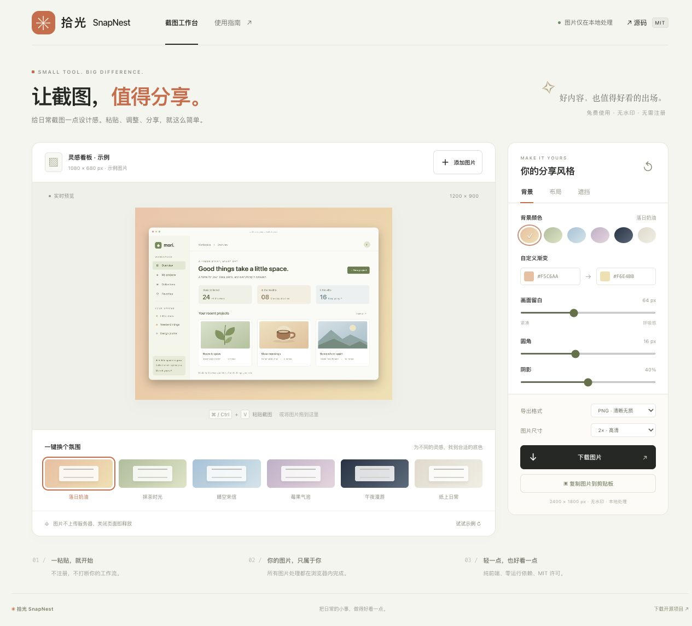

# 拾光 SnapNest

**让截图，值得分享。** 本地截图美化与隐私遮挡：一个纯前端网页工具，以及可以在脚本和 CI 中使用的 Node.js API / CLI。

[在线使用](https://batype.github.io/snapnest/) · [下载发行版](https://github.com/batype/snapnest/releases) · [报告问题](https://github.com/batype/snapnest/issues) · [MIT 许可证](LICENSE)



## 能做什么

- 粘贴、拖拽或选择 PNG / JPG / WebP 图片，实时预览。
- 六种背景、自定义渐变、留白、圆角和阴影。
- 自适应、4:3、1:1、3:4、16:9；浏览器边框和底部标题。
- 实心隐私遮挡，支持撤销和清空，遮挡写入导出像素。
- PNG / JPG、1× / 2× 导出；浏览器支持时可复制 PNG。
- 中文响应式界面、样式记忆；无水印、无登录、无图片上传。
- Node API、TypeScript 类型声明和命令行；适合自动生成项目展示图。

**网页零运行依赖；Node 图片渲染使用 sharp。** 页面不会加载 Node 依赖或连接任何图片处理 API。

## 本地运行网页

需要 Node.js >=20.9.0（Node 图片库的最低版本）。只运行网页不需要安装依赖：

```sh
git clone https://github.com/batype/snapnest.git
cd snapnest
npm run build
npm run dev
```

打开 http://127.0.0.1:4173 。浏览器通常不允许 file:// 页面加载 ES Modules，请通过开发服务器访问。

完整开发和验证：

```sh
npm ci
npm test
npm run build
```

## 安装 Node 插件

目前提供 **GitHub 安装和 Release 中的 npm 压缩包**，尚未发布到 npm 公共注册表。不要使用 `npm install @batype/snapnest`，请使用下面的安装方式。

```sh
npm install github:batype/snapnest#v1.1.0
```

无需长期安装时：

```sh
npx --yes --package=github:batype/snapnest#v1.1.0 snapnest ./screenshot.png --out ./share.png --theme matcha
```

也可克隆后执行 `npm ci`，然后运行 `node bin/snapnest.mjs`。Node 原生图片依赖由 sharp 为支持的平台提供；离线环境需提前准备依赖。

### 命令行 CLI

```sh
snapnest screenshot.png --out share.png --theme sunset --ratio 4:3
snapnest screenshot.png --out square.jpg --ratio 1:1 --scale 2 --caption "My new project"
snapnest screenshot.png --out redacted.png --masks masks.json --no-frame
snapnest --list-themes
snapnest --help
```

在项目本地安装时，也可用 `npx snapnest` 调用。`--out` 省略时默认写为 `<原文件名>-snapnest.png`。通过 `.png` / `.jpg` / `.jpeg` 扩展名选择编码格式。现有输出文件默认受到保护，只有 `--force` 才允许覆盖；始终拒绝将输入路径作为输出路径。

主题：`sunset` 落日奶油、`matcha` 抹茶时光、`sky` 晴空来信、`berry` 莓果气泡、`midnight` 午夜漫游、`paper` 纸上日常。

`masks.json` 是相对**旋转校正后的原图内容**的矩形数组，坐标均为 0–1：

```json
[{ "x": 0.1, "y": 0.2, "w": 0.35, "h": 0.08 }]
```

### JavaScript API

```js
import { beautify, beautifyToFile, themes } from '@batype/snapnest';
import { writeFile } from 'node:fs/promises';

// 文件路径、Buffer 或 Uint8Array 均可作为输入。
const buffer = await beautify('./screenshot.png', {
  theme: 'matcha',
  ratio: '4:3',
  scale: 2,
  caption: 'A small project, well shared.',
  masks: [{ x: 0.1, y: 0.2, w: 0.35, h: 0.08 }],
});
await writeFile('./share.png', buffer);

// 自动根据输出扩展名选择 PNG / JPEG，默认不覆盖已有文件。
const info = await beautifyToFile('./screenshot.png', './share.jpg', {
  theme: 'sky', browserFrame: false,
});
console.log(info); // { path, format, width, height }
console.log(themes);
```

参数和 TypeScript 类型见 [node/index.d.ts](node/index.d.ts)。参数约束：padding 16–140、radius 0–40、shadow 0–80、scale 1 或 2；颜色使用 `#RRGGBB`；caption 最多 40 个字符。Node 使用 SVG / sharp，网页使用 Canvas，共享布局逻辑；字体与光栅化随系统而异，不承诺像素完全一致。

## GitHub Pages

推送到 `main` 后，[Pages workflow](.github/workflows/pages.yml) 会：

1. 安装锁定依赖，运行网页核心和 Node 集成测试。
2. 构建网页内可下载的完整源码 ZIP，检查 npm 包内容。
3. 将 `dist/` 发布到 GitHub Pages。

PR 只运行检查；不部署。工作流使用 GitHub 自动提供的临时权限，不需要添加 PAT 或部署密钥。

Fork 后：仓库 Settings → Pages → Source 选择 **GitHub Actions**，然后运行工作流。所有网页资源使用相对路径，支持仓库子路径。Fork 时请在 package.json、README 和页面的 GitHub 链接中更新自己的仓库信息。

也可直接将构建后的 `dist/` 部署到其他静态站点服务。网页无需 API Key、后端或环境变量。

## 隐私与限制

图片和标题不上传服务器；图片、标题与遮挡区域不写入 localStorage，仅保留样式偏好。刷新后不恢复图片。自托管平台的访问日志由平台自身管理。

支持 PNG、JPEG 和 WebP，单图不超过 25 MB、2400 万像素；最长导出边不超过 4096 px。原图完整适配，不裁剪；动画图片只处理静态帧。Node 会先按 EXIF 校正方向再应用遮挡。浏览器复制图片需要 HTTPS / localhost 和浏览器支持，失败时可下载。

遮挡需人工框选，**不自动识别敏感信息**。分享前检查导出图片是否完整遮住敏感内容。工具处理已有截图，不直接采集桌面画面。

## 项目结构

```text
dist/                   直接维护的前端源文件 / 静态发布目录
  core.mjs              网页与 Node 共用的参数与布局逻辑
  app.mjs               Canvas 编辑器与导出
node/                   Node.js API 和 TypeScript 类型
bin/snapnest.mjs        命令行入口
scripts/                静态服务器和零依赖源码 ZIP 构建
tests/                  网页核心与 Node / CLI 集成测试
.github/workflows/      测试与 Pages 自动部署
assets/                 原创界面预览
docs/                   选题分析、发布方案和验证记录
```

`npm run build` 生成 `dist/snapnest-source.zip`，供网页使用指南中下载；不包含 `.git`、依赖目录、托管配置或安装包。`npm pack` 只打包 Node API、CLI 和共享核心，不会携带截图、测试文件或工作流。

## 参与和许可

欢迎通过 [Issues](https://github.com/batype/snapnest/issues) 或 PR 反馈真实使用场景。贡献说明见 [CONTRIBUTING.md](CONTRIBUTING.md)。示例看板与示例图形为项目原创 SVG，网页使用系统字体，无远程字体和 CDN。

MIT © 2026 batype and SnapNest contributors
